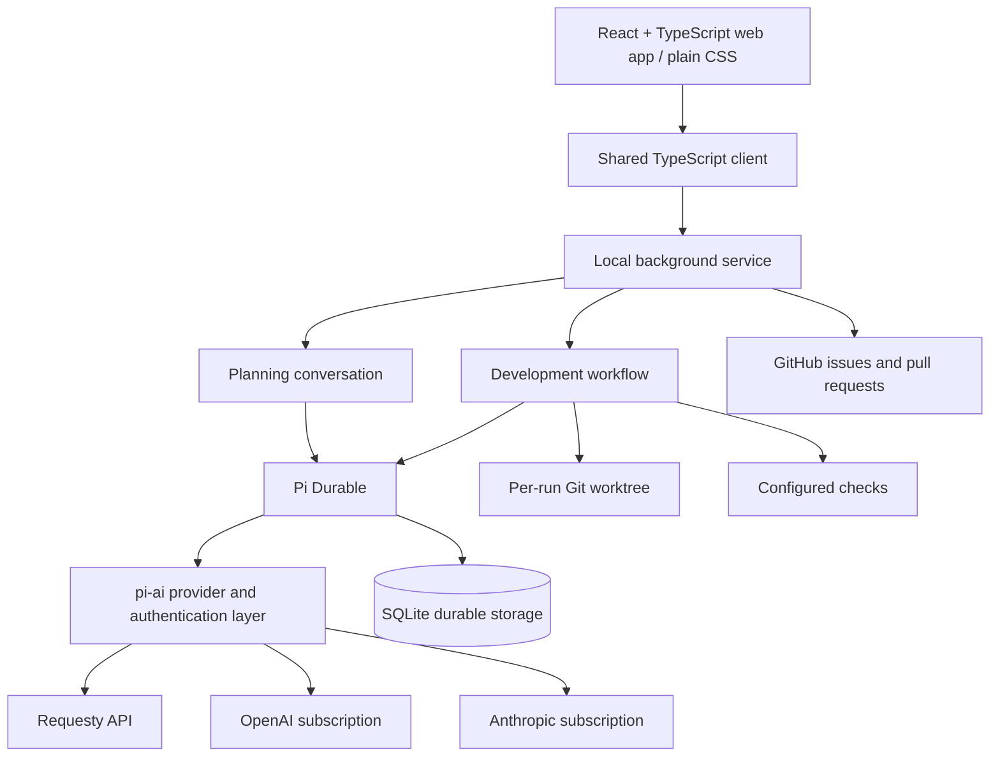

# Durable Factory — Architecture

Status: architecture reference; stages 1–4 complete. Later workflow capabilities remain planned. See IMPLEMENTATION.md for delivery status.

## Purpose and first-version boundary

Durable Factory is a personal, locally hosted web application for turning a planning conversation into a GitHub issue and implementing that issue through a recoverable development workflow.

The user and an LLM agree on the desired behavior before development starts. Agents implement and review the change; automated checks provide executable evidence. The system opens a ready-for-review pull request after validation succeeds. The user decides whether to merge.

The first version supports one configured repository and one active development run. It supports all three model connections from the outset: Requesty, OpenAI subscription authentication, and Anthropic subscription authentication through Pi's model layer. Multiple repositories and parallel runs are future extensions.

## Components and responsibilities



### Web application

Build the web application and chat interface with React and TypeScript, styled with plain CSS. Use project-owned components and CSS variables for shared colors, spacing, and typography. Do not add a CSS framework, component library, or chat library in the initial implementation.

Provide persistent planning chat, ticket and issue links, a development queue, run details, live progress, check results, reviewer findings, and questions requiring an answer. Settings configure the repository, check commands, and each role's provider and model. Provide start, pause, resume, and cancel controls. Closing the browser does not stop the background service.

Make chat the main working surface: a sidebar lists planning conversations and development runs; the main panel displays the selected conversation. Provide project-owned React components for the transcript, message composer, expandable tool calls and results, pending questions, and workflow status. Keep planning, developer, and reviewer conversations distinct and accessible from their associated run.

Add a compact run inspector showing the stage, repair count, active task or check, pending questions, selected models, recovery events, and available usage information. Show browser connection status separately from execution status: a disconnected browser does not imply a stopped agent. Display token usage when reported by the provider; label cost estimates and unavailable values explicitly. Subscription usage is not equivalent to per-token billing.

### Chat integration and shared client

Pi Durable owns the agent conversation engine: stored history, model calls, tool execution, committed updates, and recovery. The React frontend renders that state and submits user actions through the local service. The application implements ticket creation and development workflow rules around the harness; it does not introduce a second agent loop or treat browser state as authoritative history.

Use a framework-independent TypeScript client layer for typed requests, streamed events, transcript view state, and reconnection. Send messages with stable request IDs so a retried submission is not admitted twice. Use HTTP requests for actions and Server-Sent Events for server updates. The service adapts Pi Durable's supported APIs to this application interface; do not assume the harness ships the example application's HTTP API.

On initial connection and reconnection, load an authoritative snapshot, then apply ordered committed updates. Coordinate the snapshot and stream so updates cannot be missed between them. Show disconnected and pending-send states, preserve unsent input, and avoid duplicating messages or tool results after reconnecting. Credentials remain in the local service.

Keep transcript conversion and streamed-state reduction in the shared TypeScript client, independently of React. Use stable entry IDs to update partial messages and tool output. Fetch older transcript pages on demand rather than loading unbounded history into every browser snapshot.

Use queued follow-ups by default when a planning or developer agent is busy. Show the queue and allow withdrawal before an input is consumed. Offer an explicit developer-only steering action that applies at a supported tool boundary; it cannot change the agreed acceptance criteria implicitly or bypass validation gates. Any resulting source change invalidates previous validation. Reviewer conversations remain inspection-only for the user; answers to reviewer questions are submitted through the run's intervention controls, not arbitrary chat instructions.

Deliver developer input through the workflow at controlled stage boundaries, not through an independently running developer inbox during validation. During checks or review, hold incoming developer guidance until current work is quiescent; implementation-changing guidance returns the run to development and then through checks and review. Do not start publication with undelivered developer input: handle it or let the user withdraw it first. Once publication starts, reject new implementation input without admitting a submission, disable the developer composer, and stop automatic developer edits. Preserve any local unsent draft. After PR readiness, further implementation requires an explicit new run; inspection and run controls remain available.

Define a versioned application contract, initially `/api/v1`, with shared TypeScript types for actions, snapshots, streamed events, and errors. Distinguish acknowledged, queued, running, completed, interrupted, failed, and withdrawn submission states. Acknowledgement means the submission is durably accepted, not that the requested work has completed. Return a submission ID and retain the request ID for reconciliation after an ambiguous response. Use typed error codes for invalid input, conflicts, busy work, authentication, unavailable providers, and internal failures; distinguish a transport disconnect from a terminal submission failure. Include the API version in the initial stream handshake and report unsupported versions clearly.

Send heartbeat comments every 15 seconds and treat 45 seconds without any stream traffic as a lost connection. Reconnect with capped exponential backoff and jitter, then restore from a fresh snapshot. Bound each connection's outgoing buffer and tool-output window; disconnect slow clients rather than allowing unlimited memory growth. Preserve complete logs as referenced artifacts and let the client fetch additional output explicitly. Closing or replacing a stream never cancels work.

The initial interface is a normal browser chat, without an embedded terminal or a separate TUI process. A future terminal client could consume the same shared client contract.

### Reference implementation: durable-pi

Use [disler/durable-pi](https://github.com/disler/durable-pi) as an architecture and implementation reference. Its browser interface uses Vue, and its separate Pi-like terminal client uses Pi's TUI library. Both consume shared conversation state through its `dpi-sdk`; the browser does not render the terminal interface.

Study its [shared SDK](https://github.com/disler/durable-pi/blob/main/apps/dpi-sdk/README.md) for typed requests, streaming, transcript formatting, and snapshot-based reconnection. Reuse or adapt suitable framework-independent code after checking compatibility with the pinned Pi versions. Its SDK is repository-local rather than a published npm package. Build the presentation layer in React instead of importing its Vue components. Reuse does not require adopting its multi-device hub or network deployment features.

Preserve MIT license notices and attribution for any copied or adapted code. The example is a reference, not a required runtime dependency.

The example's documented behavior includes named durable job phases, stored human approvals, a typed HTTP/SSE contract, snapshot-based recovery, and deterministic fake-provider tests. Consult its [backend API](https://github.com/disler/durable-pi/blob/main/apps/dpi-backend/API.md), [job records](https://github.com/disler/durable-pi/blob/main/apps/dpi-sdk/src/jobs.ts), [storage layout](https://github.com/disler/durable-pi/blob/main/apps/dpi-backend/README.md#layout-on-a-device), and [testing documentation](https://github.com/disler/durable-pi/blob/main/apps/dpi-backend/README.md#development).

The role-specific workflow, React inspector, intervention records, and GitHub reconciliation rules in this document are Durable Factory adaptations, not claims that the example already implements our factory. Reuse typed client, transcript, reconnection, and checkpoint patterns where appropriate. Keep the example's multi-device hosting, separate hub, terminal client, conversation forks, demo jobs, and third-party command judging outside the first version. Do not inherit its OpenRouter-only model setup in place of our three agreed model connections.

### Local background service

One local background service serves the built React application and its API, and owns GitHub polling, the queue, run admission, Git operations, check execution, and browser updates. Use TypeScript on a supported Node.js runtime as the initial implementation direction, with Pi Durable and pi-ai versions pinned together after compatibility verification.

Run independently of the browser. Startup is currently manual through the repository Bun command; automatic startup at login is deferred. A sleeping or powered-off computer performs no work; recovery begins when the service runs again. Bind the application to localhost for the personal first version.

Keep persistent databases, logs and artifacts in a configurable application-data directory outside the application source checkout and target repository. Store private credentials in the operating system vault, scoped to that data directory; retain only the credential write lock in the directory after migration. Separate replaceable program code from runtime data. Worktrees remain run-scoped and their paths are recorded for recovery.

Expose process health separately from readiness. Health indicates that the process responds; readiness indicates that storage ownership is established and startup reconciliation has finished enough to admit work safely. A failed provider connection blocks the affected operation, not the whole application's inspection UI. Report startup recovery progress, unavailable runs, and unresolved external operations in the application.

On graceful shutdown, stop admission and scheduling, checkpoint supported work, and stop or account for child processes before releasing storage ownership. Interrupted unsafe commands remain subject to recovery inspection. Emit structured service logs with run, task, conversation, stage-attempt, and external-operation IDs where applicable; redact credentials and avoid logging full provider payloads by default.

Future backup tooling must use a consistent SQLite-aware snapshot, or quiesce writes and close the databases before copying them; do not copy only a live database file while ignoring its journal/WAL state. Include referenced artifacts and configuration in the backup set, and handle credentials as separately protected material. The agreed first-version cleanup permanently removes local run data automatically after GitHub confirms the original PR is merged and the issue is closed, once work is quiescent and resource ownership/content checks pass. Shared planning conversations remain until unreferenced; no archive or permanent run marker is retained. Cancellation does not delete worktrees or GitHub objects. Backup/restore tooling is deferred.

### Pi Durable and SQLite

Use Pi Durable for persistent planning, developer, and reviewer conversations and checkpointed workflow tasks. Store application workflow state in durable documents alongside the transcript where atomic coordination is required. Keep large check logs as referenced local artifacts.

Use SQLite storage owned by one service process. A process lock prevents two service instances from operating the same database. Model calls and task recovery use the harness's supported APIs; application transitions remain explicit rather than inferred from chat text.

Represent each development run as an application-owned durable workflow with checkpointed stages and repair iterations. Associate its child tasks and conversations with the run explicitly. Persist stage-attempt IDs, task/conversation IDs, timestamps, outcomes, and recovery counts alongside workflow state. Recover an interrupted stage into its existing attempt record, without recording a second success or consuming another repair cycle merely because the service restarted.

Browser subscriptions and planning turns do not own development-run lifetime. An explicit implementation command admits the run under service ownership, so finishing or interrupting the planning turn does not cancel it. Run controls govern its active child tasks, including developer/reviewer calls and checks.

### Model connections

Use pi-ai directly for all roles. Separate Codex and Claude Code worker processes are unnecessary for this design.

- Requesty: register a compatible provider using its API key and endpoint.
- OpenAI: use Pi's supported subscription sign-in flow.
- Anthropic: use Pi's supported subscription sign-in flow.

Expose provider, available model, and supported reasoning settings independently for planning, development, and review. Require explicit selections during setup rather than baking changing model names into the workflow. Capture effective role settings when work begins.

Keep credentials on the service side in macOS Keychain or Linux Secret Service, outside the target repository, Git worktrees, and ordinary logs. Use Pi's provider-owned login and token-refresh flows through local-only Settings login sessions or the terminal fallback. Login sessions and authorization codes are ephemeral and never durable conversation data. Do not assume the account has access to every catalog model or that subscription billing rules are identical across providers; model availability is determined when the selected connection is used.

If authentication or usage limits prevent progress, pause the affected work. Offer retry, reconnect, or an explicit provider/model change. Never silently switch to Requesty or another paid connection. An explicit model switch preserves the durable conversation history using Pi's supported handoff behavior and records the change.

## Planning and issue creation

A planning conversation is associated with the configured repository and persists between browser sessions. The planning agent can inspect repository context but cannot edit application code or start development implicitly.

Configure planning tools for repository inspection, scoped history search, and service-backed issue creation on an explicit user instruction. An explicit implementation request calls the same service admission interface as the application's start control. Do not expose general-purpose mutation or publishing tools to the planner. Tool selection and service-side authorization enforce these boundaries; prompts alone do not.

Maintain an agreed ticket containing:

- Goal and user-visible outcome.
- Included work and explicit exclusions where relevant.
- Acceptance criteria.
- Validation approach and relevant constraints.

Create an issue only when the user instructs the agent to do so in chat. Do not require a separate preview screen. Use the latest agreed ticket as the issue body, return its link, and associate its identifier with the conversation. Ticket creation alone does not start implementation.

Persist a unique issue-creation operation identifier before contacting GitHub. Include an unobtrusive operation marker in the issue body so a timeout or restart can be reconciled before another create request.

## Starting development

Support two equivalent entry points:

1. The user starts implementation of an issue from the application, including through an explicit chat instruction.
2. An open issue in the configured repository has the `agent:ready` label.

Poll GitHub every 30 seconds while the service is available, and reconcile on service startup. Polling avoids a public webhook endpoint. Label-based starts do not require an agent assignee or GitHub Projects status in the first version.

Both entry points call the same admission operation keyed by repository identity and issue number. Return an existing queued, active, paused, or completed run rather than creating a competing one. Retrying a completed or cancelled issue requires an explicit new run request. A persistent label must not repeatedly enqueue completed work.

Use a durable queue with concurrency set to one. Multiple ready issues may wait, but only one development run executes at a time. A run releases its execution slot only after its active mutating work has stopped or reached a confirmed safe boundary. Paused runs preserve their worktree and state; resuming one must reacquire the slot before execution continues.

At admission, capture the issue title/body, acceptance criteria, issue update timestamp, base branch and commit, role settings, and effective setup commands, required checks, and operation timeouts. Store the effective configuration and its revision with the run. Treat the issue snapshot as the run's specification. Later issue edits do not silently change active work; the user can explicitly adopt an updated specification, which invalidates prior validation. Settings changes apply to future runs by default. Before publication starts, the user may explicitly adopt changed configuration for the current run; record that decision and invalidate affected evidence. Changes to setup commands require dependency setup to be repeated before development resumes. Once publication starts or a PR is ready, changes to the implementation/specification or captured execution configuration require an explicit new run. Credential replacement or reconnection may resume the same interrupted operation without changing its validated source or captured execution configuration.

## Development workflow

```text
Queued → Developer → Checks → Reviewer → Publish PR → PR ready
             ↑         │          │
             └─────────┴──────────┘
                 failure or findings

Any active stage → Pause / input / cancel requested → Quiesced paused / Needs input / Cancelled
```

Each stage attempt belongs to a run and repair iteration. Record its start, result, validated revision when applicable, and completion before advancing. Check success and a structured reviewer pass for the same revision are publication prerequisites; agent statements such as "done" do not authorize a transition. A developer edit or adopted specification change invalidates affected validation. On recovery, inspect the current attempt and committed evidence before scheduling more work.

### Developer

Create a dedicated branch and Git worktree from the configured base branch. Preserve the user's existing working directory and uncommitted changes. Give the developer the issue snapshot, repository instructions, relevant context, prior check failures, and outstanding reviewer findings.

The developer implements the change and relevant tests. Product ambiguity or an impossible requirement produces a stored question and pauses the run instead of guessing. GitHub publishing and merge operations belong to the service, not to autonomous developer tools.

Configure the developer's file and command tools for its recorded run worktree. Give it scoped history search and a service-backed way to raise questions, but do not offer issue/PR publishing or merge tools. Tool filtering and worktree isolation are application boundaries, not operating-system sandboxes: arbitrary shell code has the permissions of its execution environment. Stronger filesystem, network, or credential isolation requires a separately defined sandbox; do not describe the first version as providing one.

### Automated checks

Run repository-configured lint, type-check, test, and build commands as applicable. Discover existing project commands during setup and have the user select the required gate; do not silently omit checks or invent a generic passing command. Run the configured gate after development. Do not run baseline checks before implementation; approved targeted regression proof still compares base and candidate after development.

Execute setup and required checks from the run's captured configuration, not mutable current settings. Stop developer mutations and ensure its mutating tools and child processes are quiescent before validation begins; keep automatic developer work stopped throughout checks and review. Capture the Git tree/content identity of the files intended for the commit, including generated files that will be committed and intended additions/deletions. Exclude only disposable build output that will not be committed. Compare source identity before and after the checks and before accepting review evidence. If checks or other work change the intended source, invalidate affected evidence and validate the resulting source state again. This uses the existing run/evidence records, not another snapshot subsystem.

Save command, exit code, output location, duration, validated source identity, and effective configuration revision with the evidence. Failed required checks return actionable output to the developer. Missing setup or infrastructure failures pause for intervention rather than being presented as successful validation. Operation timeouts are configured during repository setup and captured per run; expiration follows the bounded interruption and reconciliation rules under Human intervention and run controls.

### Independent reviewer

After checks pass, start a fresh reviewer conversation for the current revision. Provide the issue snapshot, diff, repository context, check evidence, and previous findings to verify resolution. The reviewer can inspect code and evidence but cannot modify the implementation or publish changes.

Offer read-only repository/evidence tools, scoped history search, and a structured review-result/question interface. Exclude write/edit, general-purpose shell, publishing, and merge tools. Checks execute through the configured service gate rather than an unrestricted reviewer command tool. Enforce this tool set through harness configuration and validate review-result submissions against the current run and revision.

Require a structured result: `pass`, `changes_requested`, or `needs_input`, with concrete findings tied to requirements or code. All requested changes block publication. Non-blocking observations are explicitly distinguished. Invalid or incomplete review output cannot count as approval.

### Repair limit

Allow one initial implementation attempt and at most three repair cycles. A failed check gate or a `changes_requested` review consumes the next repair cycle when the developer starts fixing it. Each repair runs the full check gate again, then a fresh review if checks pass.

If the third repair still fails validation, pause with the latest evidence and unresolved findings. Only developer work triggered by failed required checks or requested reviewer changes consumes a repair cycle. User guidance, adopted specification/configuration changes, base-branch updates, answers, transient transport retries, and authentication recovery do not themselves consume a cycle and never silently reset the existing count. If user guidance accompanies an outstanding validation failure, the resulting repair still consumes its normal cycle. Continuing beyond the cap requires an explicit user action recorded on the run.

### Pull request handoff

Publish only the exact source identity that passed both checks and review under the run's effective configuration revision. Immediately before publication, verify those identities and confirm developer work is stopped and no developer input remains undelivered. If the source or effective configuration differs, invalidate affected evidence and return through validation before publishing. Before publishing, verify that the base branch has not moved; if it has, update the branch and rerun validation. Conflicts return to the developer under the existing repair-accounting rules, or pause if user input is required. No automatic developer edits are allowed during publication or after PR readiness.

Commit locally and verify that the resulting commit tree matches the validated source identity before pushing. If commit hooks or staging change the intended content, invalidate affected evidence and return through validation. Then push the dedicated branch and open a non-draft PR referencing the issue. Include the change summary, checks performed, review result, and any non-blocking observations. Before any remote write, hook-produced content may repeat service-controlled checks and fresh review through an explicit intervention; implementation input stays closed. Further developer edits require a new run. Record the PR URL and mark the run `pr_ready`. Never merge automatically. Keep the issue open until the user merges or closes it through their normal GitHub workflow.

## Durable state and recovery

Persist these logical records without requiring a fixed database schema in this initial document:

| Record | Essential contents |
| --- | --- |
| Repository | Stable ID, local path, GitHub identity, base branch, required checks and timeouts |
| Planning session | Conversation ID, repository ID, current ticket, linked issue, pending creation operation |
| Run | Run ID, repository/issue identity, specification snapshot, effective setup/check commands and operation timeouts, configuration revision, status, stage, repair count, role settings, current attempt, revision |
| Workspace | Run ID, branch, worktree path, base revision, current revision |
| Evidence | Check results, reviewer verdict/findings, validated source identity, effective configuration revision, artifact references |
| Intervention | Intervention ID, run/task/conversation IDs, reason/question, pending/resolved state, revision, answer, explicit provider changes, continuation decisions |
| External operation | Operation ID, intent, reconciliation evidence, result, linked GitHub object |
| Task ownership | Run ID, parent/child task IDs, conversation IDs, lifetime and cancellation scope |
| Stage attempt | Attempt ID, run/stage/repair iteration, task/conversation IDs, timestamps, outcome, evidence revision, recovery count |
| Submission | Submission/request IDs, conversation ID, queue position, queued/steer mode, status, result/error, withdrawal state |

Persist state transitions before scheduling the next stage. On restart, inspect unfinished tasks and reconcile their observable effects. Do not equate a saved transcript with exactly-once external execution.

Use atomic transactions for related workflow updates and revision checks for commands acting on shared records. A stale browser must receive a conflict and refresh rather than overwrite newer state. Guard stage completion so repeated callbacks cannot advance the workflow or count a repair twice.

Keep stored history after context compaction or reset. Expose paginated transcript retrieval to the UI and a scoped history-search tool to planning, developer, and reviewer agents. Use Pi's model-window-aware compaction behavior instead of copying the example's fixed thresholds. Persist the agreed specification, current validation evidence, and unresolved findings as durable documents; context summaries are aids to reasoning, not the sole source of those records.

Declare tool replay policies explicitly. Read-only queries can be replay-safe; external writes and commands with uncertain side effects need reconciliation or interruption handling. Recovery increments the existing attempt's recovery count, preserving stage timestamps and outcomes without appending duplicate successful attempts.

- Issue creation: find the stored operation marker before creating again.
- Git changes: inspect branch/worktree state and existing commits before repeating a Git operation.
- Push: compare local and remote branch revisions; avoid rewriting unrelated remote changes.
- PR creation: search for the run's head branch and operation marker before creating another PR.
- Interrupted commands: establish that the old process has exited before retrying; rerun only commands declared safe to replay. Otherwise pause for inspection.

Publication remains pending after an ambiguous response until reconciliation establishes success or failure. Credentials are never included in recovery records.

## Human intervention and run controls

Show pending questions and failures in the application. Persist each intervention with a stable ID, originating run/task/conversation, reason, question, revision, and pending/resolved state. Submit answers against that intervention ID and expected revision. Accept one answer; a retry of the same answer operation returns its stored result, while stale or conflicting answers are rejected. Commit the answer and resolution before resuming the originating task in the same run.

Withdrawing queued input removes a message that has not been consumed; it does not undo an active tool or cancel a run. A consumed input cannot be withdrawn. A pause request stops scheduling new stages, permits supported interruption or completion to a safe boundary, then preserves work for inspection. Show pausing until active work is quiescent; only then mark the run paused or waiting for input and release its execution slot. Pause is not a success state. An answer or resume request makes the run eligible to reacquire the execution slot; it does not execute concurrently with another active run.

Cancellation prevents new agent work or publication and propagates cancellation to the run's active child tasks through supported APIs. Show cancelling until active work has stopped and ambiguous effects are recorded for reconciliation. An already-issued external request may still finish; record its result rather than claiming it was undone. Preserve branches, worktrees, evidence, and any already-created GitHub objects; cleanup is an explicit later action. Do not automatically undo an external action that completed before cancellation was observed.

Define configurable deadlines for setup commands, developer tools, required checks, provider requests, and cancellation attempts. Capture them with each run's effective configuration; waiting for a human answer is not active execution and does not expire under a provider/tool deadline. A timeout records the operation and reason, requests cancellation through supported APIs, and bounds the wait for shutdown. For local commands, terminate the service-owned process group and account for its child processes; for provider requests, stop accepting results from an interrupted attempt. Do not automatically replay uncertain side effects.

If termination cannot be confirmed, show a termination blocker and retain the execution slot; do not report the run as safely paused/cancelled or start another development run. Resume scheduling only after process inspection confirms that no prior mutating work remains active. A provider result arriving after interruption cannot advance the workflow. Timeout handling does not silently reset the repair count; failed-check repairs follow the existing repair rules, while infrastructure/termination blockers require intervention.

## Groundwork for expansion

Use repository IDs on every session and run rather than a global repository path. Pass run-scoped workspaces and credentials explicitly. Keep scheduling, workflow transitions, model connections, and GitHub access behind separate interfaces.

Keep global concurrency at one initially. Future parallel execution can introduce per-repository limits and workspace/resource locks without changing role behavior or run identity. Multiple worktrees isolate files; dependency conflicts and overlapping changes will still require scheduling and fresh validation against the target branch.

## Testing strategy

Use a deterministic fake model provider plus fake GitHub and controlled command-execution adapters for repeatable offline workflow tests. Script developer/check/reviewer outcomes, tool calls, questions, and provider errors rather than relying on an LLM to generate the failure under test. Exercise the actual workflow transitions and durable storage with these adapters; the example's [fake-provider and recovery tests](https://github.com/disler/durable-pi/blob/main/apps/dpi-backend/README.md#development) are a reference, not evidence that Durable Factory already passes them.

Force service termination at stage boundaries, during safe and unsafe tools, after an external effect but before its response is recorded, and while waiting for an answer. Restart against the same data and verify ownership, attempt identity, repair count, results, and one resulting GitHub issue/PR. Distinguish an interrupted model request from a failed code-validation attempt.

Test stream snapshots, heartbeat loss, slow-client eviction, reconnect backoff, duplicate submissions, withdrawal races, stale/conflicting answers, and cancellation propagation. Use browser tests for the run inspector, queued input, restored conversations, and pending questions. Verify old history is searchable after compaction and updates remain revision-safe across two browser tabs.

Exercise provider errors, token refresh, usage-limit handling, and explicit provider changes with deterministic offline adapters. Include service shutdown/restart and merged-run cleanup scenarios using disposable data. Backup/restore smoke scenarios are deferred with backup tooling. Automated verification must not depend on production repositories, provider accounts, or paid calls.

## Acceptance scenarios

1. Planning survives browser/service restarts; a chat instruction creates one issue with the agreed ticket and returns its link.
2. Manual start and the ready label enter the same workflow. Concurrent or repeated triggers yield one run and one worktree.
3. A successful run passes required checks and independent review, then opens one non-draft PR. No automatic merge occurs.
4. Failed checks return their evidence to the developer; the reviewer is skipped until the gate passes.
5. Reviewer findings return to the developer. A subsequent change invalidates earlier checks and review.
6. The initial attempt plus three unsuccessful repairs pauses with useful evidence; no fourth repair starts automatically.
7. Ambiguous requirements produce a question; answering resumes the same run with the answer recorded.
8. Authentication failure or exhausted usage pauses without automatic paid fallback; explicit retry or provider change resumes work.
9. Restart during development or review recovers unfinished work; restart after an uncertain issue/PR creation reconciles the object instead of duplicating it.
10. An interrupted unsafe command pauses for inspection; safe checks can be rerun after the prior process is confirmed stopped.
11. A moved base branch forces updated validation before publication. Existing user changes remain untouched.
12. Several queued issues execute serially. A persistent ready label does not restart completed work.
13. Cancellation preserves evidence and stops future publication. Invalid reviewer output never opens a PR.
14. React chat renders streamed replies, tool calls/results, and current workflow status from committed server updates.
15. Browser reload or network reconnection restores the selected conversation and catches up without missed or duplicated transcript entries; pending input remains recoverable.
16. A retried send uses the same request ID and creates one submission. Reopening saved planning, developer, and reviewer conversations shows their persisted histories.
17. The frontend uses React, TypeScript, and plain CSS without a CSS framework, component library, or chat library.
18. The inspector distinguishes an offline browser from a working, paused, or blocked run; reported usage and cost estimates remain clearly labelled.
19. Busy planning/developer conversations queue follow-ups by default. Explicit developer steering applies at a supported boundary, and reviewer conversations reject ordinary user chat input.
20. Withdrawing unconsumed input prevents delivery; withdrawing consumed input reports a conflict without undoing executed work.
21. Duplicate answer submissions resolve one intervention once; stale/conflicting answers do not resume work or overwrite a newer decision.
22. Restarting a stage retains its attempt ID, increments its recovery count, and neither counts another repair nor records a second successful completion.
23. Pause and cancellation reach active child tasks; the execution slot is not reused while earlier mutating work is still active. Browser closure or a completed planning turn does not cancel a development run.
24. Required role tools are configured through the harness and service: the reviewer cannot edit, run unrestricted shell commands, or publish changes.
25. After compaction, paginated history and scoped agent search retrieve earlier decisions; the current specification and unresolved findings remain in durable documents.
26. A slow or silent stream reconnects from a fresh snapshot with bounded buffers and no duplicate results; unsupported API versions produce an explicit error.
27. Application upgrades leave external runtime data intact. Merged-run cleanup removes local run data only after confirmed PR merge and issue closure, preserving other runs and shared planning. Backup/restore is deferred.
28. A deterministic offline suite exercises success, repair exhaustion, external-action reconciliation, provider failure, stale updates, and forced restarts without provider accounts or paid model calls.
29. Changing repository check/setup settings leaves an existing run's captured configuration unchanged; explicit adoption records a new revision, repeats dependency setup where needed, and invalidates affected evidence.
30. Developer mutations stop before checks/review. Source changes during validation invalidate affected evidence; committed generated files remain part of the source identity, while disposable build output does not.
31. Developer guidance arriving during checks/review is delivered at a controlled boundary and implementation changes return through validation. Publication waits for pending developer input to be handled or withdrawn; new implementation input is rejected after publication starts, and post-PR implementation requires an explicit new run.
32. User guidance and configuration/specification changes neither consume a repair cycle by themselves nor reset the count. Guidance that accompanies a failed-check/reviewer repair does not bypass that cycle's accounting.
33. Setup, tool, check, provider, and cancellation deadlines produce recorded interruption outcomes; late provider results cannot advance an interrupted attempt, and human-answer waits are not treated as provider timeouts.
34. If a mutating process cannot be confirmed stopped after a bounded cancellation attempt, the run shows a termination blocker and keeps the execution slot until reconciliation confirms quiescence.

## Reference material

Provider support and APIs must be checked against the pinned versions during implementation.

- [Pi Durable introduction and recovery model](https://earendil.com/posts/pi-durable/)
- [pi-ai provider authentication and OAuth](https://github.com/earendil-works/pi/blob/main/packages/ai/README.md#oauth-providers)
- [Pi provider configuration](https://pi.dev/docs/latest/providers)
- [Requesty quickstart](https://docs.requesty.ai/quickstart)
- [durable-pi example: web and terminal clients on Pi Durable](https://github.com/disler/durable-pi)
- [durable-pi shared SDK and transcript client](https://github.com/disler/durable-pi/blob/main/apps/dpi-sdk/README.md)
- [durable-pi backend API: messages, history, jobs, and streams](https://github.com/disler/durable-pi/blob/main/apps/dpi-backend/API.md)
- [durable-pi durable job record types](https://github.com/disler/durable-pi/blob/main/apps/dpi-sdk/src/jobs.ts)
- [durable-pi storage layout](https://github.com/disler/durable-pi/blob/main/apps/dpi-backend/README.md#layout-on-a-device)
- [durable-pi backend testing and recovery checks](https://github.com/disler/durable-pi/blob/main/apps/dpi-backend/README.md#development)

## Handoffs and evidence extension

The combined handoffs release extends the existing documents and `/api/v1` snapshots, without another queue, database, model role or agent loop. New real runs pin contract version 2; absent versions retain the legacy contract. Planning persists explicit numbered criteria and regression requirements and previews the entire issue before authorization. Developer reports, criterion assessments and optional regression evidence bind to existing candidate/configuration/specification identities. Temporary proof worktrees have durable ownership and supervised commands. Inspection derives the timeline from existing workflow records, and publication freezes its deterministic PR payload before dispatch. See docs/PLANNING.md and docs/WORKFLOW.md for the executable contract and compatibility behavior.
