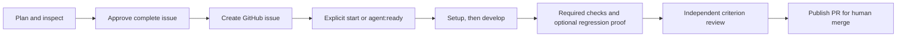

# Durable Factory

Plan a software change, approve its GitHub issue, and let a durable developer → checks → reviewer workflow prepare the pull request.

Durable Factory is a personal, locally hosted application. A Node service owns the work, Pi Durable persists conversations and workflow state in SQLite, and a React interface lets you plan, steer, and inspect it. Closing the browser does not stop accepted work. Interrupted external effects are reconciled before retrying, and you decide whether to merge.

The backend also exposes an [AG-UI 1.0 integration](docs/AG_UI.md) for compatible clients. Our chat components consume AG-UI observation views; durable workflow controls retain their factory APIs.

## What it does

- **Plan with repository context.** Chat with an agent that can inspect files, uncommitted changes, and conversation history without editing code.
- **Approve the complete issue.** Review its goal, scope, numbered acceptance criteria, validation approach, and regression-proof requirements before creation.
- **Implement in isolation.** Each run gets a dedicated Git branch and worktree. Your original checkout and uncommitted changes stay separate.
- **Require evidence.** Development produces a structured handoff, required commands run directly, and a fresh independent reviewer assesses every acceptance criterion against the candidate tree.
- **Prove regressions when requested.** An approved targeted test must fail on the base with the expected signature and pass on the candidate.
- **Inspect and recover.** Follow the run timeline, command output, repair causes, human questions, reports, and current or superseded evidence.
- **Prepare a PR.** Publish a non-draft pull request with an implementation summary, acceptance evidence, validation, and remaining limitations. Nothing is merged automatically.

The current version supports one configured repository and one active development run, with additional runs queued. Planning, development, and review have independent provider/model settings.

## Requirements

- **Node.js 24** — runs the backend, diagnostics, and tests.
- **Bun 1.4.3** — installs dependencies and runs frontend/build commands.
- **Git**, a local checkout of the repository you want to work on, and a GitHub.com repository with issues enabled.
- **macOS or Linux** with working POSIX process inspection. Automated verification has been run on macOS; Linux uses the same supported supervision path but has not been verified here.
- A supported model connection: Requesty API access, or Pi-supported OpenAI/Anthropic subscription authentication. Access to a listed model depends on your account.

## Quick start

```sh
git clone git@github.com:MelGGit/durable-factory.git
cd durable-factory
bun install --frozen-lockfile
bun run dev
```

Open [http://127.0.0.1:5173](http://127.0.0.1:5173). Planning chat is the home screen; configuration is at [Settings](http://127.0.0.1:5173/settings), and implementation conversations and their run inspector are on the same root page.

Vite proxies API requests to the Node service on port 4317. Configuration can be saved incrementally. No model is selected automatically, and saving commands never executes them.

For a production build:

```sh
bun run build
bun run start
```

Open [http://127.0.0.1:4317](http://127.0.0.1:4317). Node serves both the API and built frontend. Startup is manual; stop with Ctrl+C. Do not run development and production against the same data directory at the same time. Sleeping or powering off the computer suspends execution until the service runs again.

### Configure the first repository

1. Save the target repository's absolute local path, GitHub `owner/repository`, and base branch.
2. Select the planning, development, and review providers/models and configure their connections.
3. Enter setup commands if needed, at least one real required check, command/provider timeouts, and the commit author's name and email.
4. Save a repository-scoped GitHub token. The complete workflow needs Issues, Contents, and Pull requests read/write permissions; changing GitHub workflow files may require additional permission.
5. Use **Validate GitHub repository** to check readability. This does not prove write permission or model access. Open the conversation navigation to see missing execution prerequisites.

For a Bun project, setup might be `bun install --frozen-lockfile`, with required checks such as `bun run check` and `bun run test`. Use commands that actually validate your target repository.

Requesty and GitHub tokens are entered in Settings and stored privately by the service. For subscription sign-in, stop the service first and run the relevant interactive diagnostic:

```sh
bun run diagnose status
bun run diagnose login openai
bun run diagnose login anthropic
```

Use the same data-directory override for diagnostics and the service. `status` reports stored configuration without contacting providers; it is not an access check. Pi handles provider-owned token refresh when resolving authentication for a model request. The application never silently switches providers.

## From conversation to pull request



### 1. Agree and approve the issue

Create a planning conversation after saving repository and planning-model settings. The planner can list, read, and search current non-ignored files, inspect tracked changes, and search its own persisted history. It cannot edit files, run unrestricted commands, or start development implicitly.

The planner presents the entire proposed GitHub issue before asking for approval. Acceptance criteria use identifiers such as `AC-1`, with at most **100 criteria**. Every ticket explicitly says whether regression proof is required. If required, agree its command, exact test/fixture paths, and literal expected failure text before approval.

Reply **yes**, **yes please**, **create it**, or **go ahead** to approve that exact ticket revision. Changed content requires fresh approval. One planning conversation creates at most one linked issue; use another conversation for a subsequent ticket. Creating an issue does not start development or add a ready label.

For manually prepared issues, use the explicit sections and regression format documented in [Planning and the approved issue contract](docs/PLANNING.md). LF, CRLF, and mixed line endings are accepted. Missing or oversized criteria and incomplete proof instructions pause a run before setup. Update the GitHub issue, select **Adopt saved specification**, then **Resume run**. Downstream agents do not invent missing requirements.

### 2. Start implementation

Choose **Start implementation** on the linked issue, explicitly ask the planner to start its linked issue, or label an open issue **`agent:ready`**. Label polling runs at startup and every 30 seconds. Adding that label authorizes implementation and PR publication; closed issues cannot start.

Each run captures the issue, base commit, settings, models, commands, deadlines, and commit identity. Settings saves affect future runs. Adopting newer configuration or specification is an explicit recorded action that invalidates affected evidence.

Dependency setup must pass before development. Required checks run after the developer finishes. The developer works in a service-owned worktree and submits a report covering changes, criterion references, validation performed, concerns, and reviewer notes. Declared files must match the actual candidate diff, including deletions and rename paths. Ignored generated files intended for the commit must be explicitly selected.

### 3. Validate and review

Required commands run under process supervision, with real exit codes and complete paginated output. If the approved issue requires regression proof, the service creates separate base and candidate snapshots, adds only the approved test/fixture files to the base, and runs setup independently in both. The test must fail on the base with the expected signature and pass on the candidate. Setup errors, timeouts, unrelated failures, and source mutations do not count as proof.

A fresh inspection-only reviewer assesses every approved criterion with an explanation and candidate code/test references. Approval requires all criteria to be met, no blocking findings, and evidence for the same source/configuration/specification. Source changes invalidate validation.

The initial attempt allows **three repair cycles**. Check failures and requested changes return to the developer. Exhaustion pauses for a recorded decision; **Authorize one additional repair** grants exactly one. Guidance, restarts, and settings adoption do not reset the count.

### 4. Inspect and merge

Implementation chat logs the queue, timeline, elapsed stage durations, repairs, recovery events, questions, reports, criterion assessments, and command output. Browser connection status is separate from execution status. Token usage is provider-reported and conversation-wide; available Requesty cost estimates are labelled, and subscription tokens are not presented as bills.

Publication refreshes the base and repeats validation when necessary, creates a commit with the captured identity, verifies its tree, pushes the owned branch without force, and opens a non-draft PR. Its description is generated from the structured handoff and evidence, then frozen for retries. The user reviews and merges on GitHub.

Developer input closes when publication begins. New-contract runs require a report matching the final candidate, so commit-hook changes can leave publication blocked even after service-only revalidation; preserve the change and start an explicit new run when a fresh developer handoff is needed. Completed or cancelled work also requires an explicit new run; persistent labels cannot restart it.

## Recovery and controls

- Accepted messages, queued inputs, stage attempts, human questions, and external-operation identities persist in Pi's SQLite storage. Closing a browser never cancels a run.
- Drafts and uncertain sends remain in browser-local storage. Reconnect restores server snapshots; lost-response retries reuse their operation IDs rather than admitting duplicate work.
- Follow-ups queue while an agent is busy and can be withdrawn before consumption. Developer steering applies at a supported tool boundary. Implementation-changing guidance must pass through development and validation again.
- Pause and cancel preserve worktrees and evidence. Interrupted mutating commands require inspection and explicit continuation; they are not replayed automatically. Unconfirmed process termination retains the execution slot.
- Lost issue/PR responses are reconciled through durable markers across open and closed GitHub objects. A missing search result alone never authorizes repeating an uncertain write. Do not remove a marker while an operation is unresolved.
- Graceful shutdown stops admission, accounts for supervised processes, closes storage, and releases ownership. Restart reconciles existing work before allowing execution.

New real runs use the stronger handoff contract. Older stored runs retain their captured behavior and show unavailable structured evidence explicitly. Detailed state transitions and recovery rules are in [the workflow contract](docs/WORKFLOW.md); message delivery and streaming are in [the chat contract](docs/CHAT.md).

## Delete chats

Use **Delete** beside a planning or implementation chat, then confirm permanent deletion. Planning deletion keeps linked implementations. Implementation deletion keeps linked planning chats and removes the run, its agent conversations and artifacts, and the entire local worktree—including unpublished, untracked, and ignored files. GitHub issues, pull requests, and remote branches are unchanged.

Deletion stops the target's agents and commands first, then waits for unrelated work to finish before briefly reopening shared storage. Progress and blocked reasons appear beside the chat; use **Retry deletion** after resolving a blocker. Saved deletion requests resume after restart. Confirmed deletion has no undo. Ready labels cannot restart a deleted implementation; starting a new implementation explicitly allows work on that issue again.

## Automatic cleanup after merge

In real mode, the service checks recorded PRs at startup and every 30 seconds. When GitHub confirms that the original PR was merged and its linked issue is closed, cleanup runs while the application is idle.

**Cleanup permanently removes local run data:** its worktree, service-created local branch/base reference, conversations, questions, reports, validation evidence, usage, command logs, artifacts, and admission receipts. An originating planning conversation is removed only when no retained run shares it. There is no local archive or permanent completion marker. GitHub issues, PRs, merged code, and remote branches remain on GitHub; unrelated runs, settings, credentials, and browser-local drafts remain.

Changed worktree content, new or modified ignored files, substituted proof paths, active processes, or uncertain ownership block deletion and show a reason in the inspector. Cancelled runs, open issues, and unmerged/closed PRs are retained. Interrupted cleanup resumes after restart; GitHub errors and rate limits defer it. The browser may briefly reconnect during maintenance. Backup/restore tooling is deferred.

## Configuration and storage

| Variable                              | Default                             | Purpose                                                                                     |
| ------------------------------------- | ----------------------------------- | ------------------------------------------------------------------------------------------- |
| `DURABLE_FACTORY_DATA_DIR`            | Platform application-data directory | Absolute path outside this checkout and the target repository.                              |
| `DURABLE_FACTORY_PORT`                | `4317`                              | Node service port; the development proxy expects 4317 unless changed in Vite configuration. |
| `DURABLE_FACTORY_WORKFLOW_MODE`       | `real`                              | `real`, `simulation`, or `disabled`; real starts still require complete configuration.      |
| `PLAYWRIGHT_CHROMIUM_EXECUTABLE_PATH` | Playwright-managed Chromium         | Optional existing Chromium executable for browser tests.                                    |

Data defaults to `~/Library/Application Support/Durable Factory` on macOS, and `$XDG_DATA_HOME/durable-factory` or `~/.local/share/durable-factory` on Linux. Workflow state and configuration live in `factory.sqlite`. There is no separate application queue database.

Credentials live in private files under `credentials/`, outside Git and agent environments. Directory/file permissions protect them; they are **not encrypted at rest**. API responses expose credential status, not tokens. Stored credentials and provider catalogs are not proof of account access.

One service or diagnostic owns a data directory at a time using an operating-system lock. Never delete or replace `ownership.lock` or `credentials/write.lock` while a process may hold them. Legacy heartbeat-lock directories require stopping the older service and explicitly resolving its leftover lock before upgrading.

## Simulation

```sh
DURABLE_FACTORY_WORKFLOW_MODE=simulation bun run dev
```

Simulation runs the durable queue and workflow with deterministic stages: it does not call coding/review models, run repository commands, or create a workflow PR. Planning and issue creation retain their configured real behavior, so simulation mode is not an offline switch for the entire app. Simulation labels remain visible throughout.

Set `DURABLE_FACTORY_WORKFLOW_MODE=disabled` to disable starts and label polling. Existing runs retain their captured mode; simulation/disabled mode cannot execute real runs.

## Development and verification

```sh
bun run check
bun run format:check
bun run build
bun run test
bunx playwright install chromium
bun run test:browser
```

The offline suite uses real Pi SQLite storage, deterministic faux models, fake GitHub responses, and disposable repositories/data directories. It needs no account or paid model call. Recovery tests deliberately terminate child processes and check persistence, process ownership, interrupted effects, and duplicate prevention. Allow several minutes for the complete suite.

Browser tests require a built frontend and installed Chromium. Set `PLAYWRIGHT_CHROMIUM_EXECUTABLE_PATH` to use an existing compatible browser. Desktop/mobile screenshots are saved under ignored `test-results/`. See [compatibility and verification evidence](docs/COMPATIBILITY.md) for observed results and limitations; offline evidence does not claim live account access.

### Repository layout

| Path                   | Contents                                                                                                           |
| ---------------------- | ------------------------------------------------------------------------------------------------------------------ |
| `apps/server/src/`     | Local API, Pi conversations, planning, GitHub integration, workflow, process supervision, workspaces, and cleanup. |
| `apps/web/src/`        | React planning chat, settings, run inspector, and browser-local draft storage.                                     |
| `packages/shared/src/` | Typed API contracts, clients, stream reducers, approved issue format, and evidence validation.                     |
| `scripts/`             | Development/diagnostic entrypoints and disposable recovery-test workers.                                           |
| `tests/`               | Offline integration, client, workflow, and recovery tests; browser acceptance tests are in `tests/browser/`.       |
| `docs/`                | Chat, planning, workflow, and compatibility references.                                                            |

## Operating boundaries

The service binds to `127.0.0.1` and applies host/origin checks and CSRF protection. It is a personal local application. Worktrees and role-specific tools provide application boundaries, not an operating-system sandbox: repository commands and hooks run with the service user's permissions. Deliberately evading supervision is outside this boundary. Submodules require manual handling.

`/health` reports responsiveness; `/ready` reports whether ownership and startup reconciliation permit work. Provider failures leave settings and inspection available. Newer unsupported storage schemas are never overwritten. If maintenance cannot reopen storage after its bounded retries, readiness explains the required restart.

Keep runtime data outside the source checkout when updating the application. Do not copy only a live SQLite database while ignoring its WAL state. Automatic startup at login, backup/restore tooling, multi-device hosting, multiple configured repositories, and parallel development runs are deferred.

## Design references

[durable-pi](https://github.com/disler/durable-pi) informed the durable service/client and recovery patterns. [super-simple-software-factory](https://github.com/disler/super-simple-software-factory) informed explicit phase boundaries, structured handoffs, and evidence gates. Durable Factory implements its own TypeScript workflow and React interface around Pi Durable.

For deeper implementation detail, read [Architecture](ARCHITECTURE.md), [Implementation roadmap](IMPLEMENTATION.md), [Chat](docs/CHAT.md), [Planning](docs/PLANNING.md), [Workflow](docs/WORKFLOW.md), and [Compatibility](docs/COMPATIBILITY.md).
